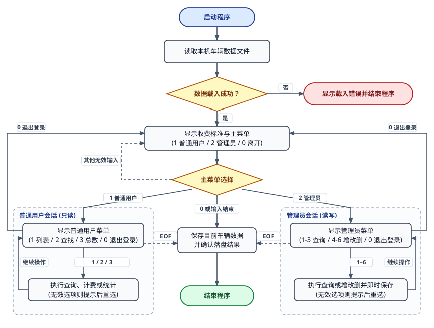

# 酒店停车场管理系统：开发报告与使用说明

**课程名称**：高级编程与软件工程（期末项目）  
**项目名称**：澳门本地酒店停车场管理系统（C++17 控制台版本）  
**开发语言与环境**：C++17 标准库（控制台界面与本机 UTF-8 文件持久化）  

---

## 小组成员与分工

| 小组成员姓名 | 学号 | 主要分工 |
| :--- | :--- | :--- |
| （请填写姓名） | （请填写学号） | 汽车信息模块开发、计费算法与本机文件存储设计 |
| （请填写姓名） | （请填写学号） | 普通用户模块、管理员用户模块与控制台菜单交互实现 |
| （请填写姓名） | （请填写学号） | 系统功能验证、全流程操作演示与开发报告编写 |

---

## 第一章　项目背景与功能需求

澳门本地某酒店需要一套简单可靠的停车场管理工具，让前线工作人员及管理人员在日常工作中记录进出车辆、查询停放时长与应收费用，并在程序关闭重新开启后保留在场车辆数据。考量酒店前台与测试环境多以桌面终端执行，系统采用 **C++17 标准库** 开发控制台应用程序，无需额外安装数据库或图形界面软件包即可独立编译与执行。

对照课程作业任务书的要求，本系统实作三个核心必做模块，并作出清楚的功能范围界定：

| 课程必做模块 | 作业要求重点 | 本系统实现内容与设计选择 |
| :--- | :--- | :--- |
| **1.1 汽车信息模块** | 添加车牌、品类、颜色与停车时间点；按车牌显示、删除、查找、修改信息；统计停留时长与车辆总数；保存数据至本机文件。 | 采用**手动输入车牌号**（不引入可选的 OpenCV 图像识别）；提供严格的字段与 `YYYY-MM-DD HH:MM` 时间校验；以 `X days Y hours Z minutes` 显示停留时长并统计 `Current count`；数据以 UTF-8 Tab 分隔格式保存于工作目录下的 `parking_data.txt`。 |
| **1.2 普通用户模块** | 查询及显示所有汽车信息与停车费（例如每小时 20 MOP、超过 24 小时按 400 MOP 计算）；统计停车时长；退出普通用户登录。 | 提供只读会话（`1 = list`、`2 = find`、`3 = count`、`0 = logout`）；计费采用「每开始 1 小时 20 MOP、每个连续 24 小时周期封顶 400 MOP」的分段累计规则；界面与底层类型双重限制普通用户不得执行任何增删改操作。 |
| **1.3 管理员用户模块** | 具备普通用户模块的全部功能，并提供增、删、改功能。 | 在共享查询功能（`1–3`）之外，提供 `4 = add`（新增）、`5 = modify`（修改）、`6 = delete`（删除）及 `0 = logout`（退出登录）；每次写入成功后立即保存至本机文件。 |

在权限与数据流方面，程序启动后透过主菜单切换角色（`1 = ordinary` 普通用户、`2 = administrator` 管理员、`0 = exit` 离开），两种角色登录后皆可随时以 `0 = logout` 退出登录并回到主菜单。为保持核心业务逻辑清晰且易于评审验证，系统不包含账号密码注册子系统、车位容量上限拦截或历史离场归档表。

---

## 第二章　系统整体设计

### 2.1 整体运行流程与模块协作

程序启动后，会先向本机数据文件载入先前保存的车辆记录，再进入控制台菜单循环，最后于退出时确认数据已妥善落盘。整体控制流程如下图所示：



配合图 1 的执行顺序，系统依职责分开建立为四层独立的 `.h` 与 `.cpp` 文件，让界面输出、权限控制、计费规则与文件读写互不混杂：

1. **程序入口与生命周期（`src/main.cpp`）**：启动时建立 `ParkingService`（内存业务服务）与 `Storage`（文件存储器），先呼叫 `storage.Load(service)` 载入本机数据。若既有文件损坏或无法读取，立即印出错误原因并以状态码 `1` 结束程序，避免启动后覆盖原有数据；载入成功后呼叫 `RunMenu()` 进入菜单循环，结束前再呼叫 `storage.Save(service)` 并依结果返回 `0` 或 `1`。
2. **菜单路由与角色隔离（`src/menus.h/.cpp`、`src/ordinary_user.h/.cpp`、`src/admin_user.h/.cpp`）**：
   - `RunMenu()` 负责显示计费规则横幅并处理顶层角色选择。
   - `RunOrdinaryUserSession()` 只接收只读参考 `const ParkingService&`，且不持有 `Storage` 物件，从编译期即保证普通用户只能呼叫 `RunReadChoice()` 执行 `1 = list`、`2 = find`、`3 = count`。
   - `RunAdminUserSession()` 接收可写的 `ParkingService&` 与 `Storage&`，除可执行共享查询（`1–3`）外，还可处理 `4 = add`、`5 = modify`、`6 = delete` 并在每次成功修改后即时保存。
3. **车辆数据管理与校验（`src/vehicle.h/.cpp`、`src/parking_service.h/.cpp`）**：统一对输入字串去空白与禁用控制字元、解析与检查日期时间，并将所有在场车辆集中管理于 `ParkingService`，由服务层检查 `Role::kAdmin` 权限与车牌唯一性。
4. **计费计算与本机持久化（`src/fee_calculator.h/.cpp`、`src/storage.h/.cpp`）**：`CalculateParkingFee()` 纯粹根据入场时间与基准时间计算时长与金额；`Storage` 则透过临时文件与备份文件机制保障读写安全。

### 2.2 一笔车辆数据的结构与流转

以一笔实际停放记录为例：当管理员输入车牌 `MA-10-01`、品类 `轿车`、颜色 `黑色` 及入场时间 `2026-11-01 08:00` 时，系统会将它封装为 `VehicleRecord`（定义于 `src/vehicle.h`）：

| 字段名称 | 范例值 | 字段用途与设计说明 |
| :--- | :--- | :--- |
| `plate` | `"MA-10-01"` | **车牌号**，去除首尾空格且禁止内部出现空格，作为系统内的唯一识别键。 |
| `category` | `"轿车"` | **汽车品类**，支持中英文与合理内部空格（如 `SUV`、`Model Y`）。 |
| `color` | `"黑色"` | **汽车颜色**，支持中英文与常见颜色描述。 |
| `entry_time_text` | `"2026-11-01 08:00"` | **标准化入场时间文字**，严格采用 16 字元 `YYYY-MM-DD HH:MM` 24 小时制格式。 |
| `entry_timestamp` | （本地整分钟时间戳） | **内部派生时间戳**，于校验通过时由 `ParseTimestamp()` 转成秒数设为 `0` 的 `std::time_t`，供后续计费直接相减，避免每次查询重复解析字串。 |

在内存数据结构选型上，`ParkingService` 使用 `std::map<std::string, VehicleRecord>` 以 `plate` 作为键值（Key）储存全部在场车辆，原因有三点：
- **天然确保车牌唯一**：每次查找、修改或删除都只需按车牌键进行 `O(log N)` 查询，并能立即拦截重复车牌。
- **输出与存档顺序确定**：红黑树依车牌字典序升序排列，无论执行 `1 = list` 显示列表还是写入 `parking_data.txt`，结果顺序都固定一致，便于人工核对与重复验证。
- **逻辑与储存解耦**：业务层不依赖阵列下标，即使中途删除或修改车牌名称，也不会影响其他车辆的索引。

当用户查询车辆时，`ParkingService` 从 `std::map` 取出 `VehicleRecord`，交由计费模块算出 `ParkingFee` 并组合成 `VehicleFeeView` 交还控制台输出；当管理员变更数据时，则把整个有序集合交给 `Storage` 依车牌顺序写入 `parking_data.txt`。

---

## 第三章　核心功能的开发逻辑

### 3.1 车辆数据变更（新增、修改与删除）

管理员的数据异动（`4 = add`、`5 = modify`、`6 = delete`）由交互层收集输入后交给业务服务层集中校验，确认通过后才更新内存并立即尝试存档。其核心流程如下：


三种写入操作在输入顺序与检查重点上有所差异，整理如下表：

| 菜单操作 | 输入顺序 | 校验与查找重点 |
| :--- | :--- | :--- |
| **`4` 新增（`AddVehicle`）** | 直接依序输入 `Plate`、`Category`、`Color`、`Entry time` | 检查四个字段与时间合法性（含非未来时间），且目标车牌不可已存在。 |
| **`5` 修改（`ModifyVehicle`）** | 先输入原车牌 `Existing plate`，再输入新的四项数据 | 先确认原车牌格式合法且存在于场内；再检查新四项数据合法；若车牌有更名，新车牌不可与场内其他车辆冲突。 |
| **`6` 删除（`DeleteVehicle`）** | 只需输入目标原车牌 `Existing plate` | 检查车牌格式合法且存在于场内，符合即从内存集合中移除。 |

**开发逻辑说明（对应 `src/admin_user.cpp`、`src/parking_service.cpp`、`src/vehicle.cpp`）**：
1. **三层输入校验（`Validated`）**：
   - `NormalizeField()` 会先拒绝 ASCII 控制字元（例如 Tab `\t` 或换行），再裁剪首尾半角空格并拒绝空字串；对车牌字段额外禁止任何内部空格（例如 `"MA 12"` 会被拒绝，`"MA-10-01"` 才合法）。
   - `ParseTimestamp()` 检查 `YYYY-MM-DD HH:MM` 的 16 字元固定格式与数字范围，依公历月份天数与闰年规则（如平年拒绝 `2026-02-29`、闰年接受 `2024-02-29`）判断后，再以 `std::mktime()` 做往返校验确保日期未发生进位溢出。
   - `NormalizeToMinute()` 将系统当前基准时间对齐至整分钟，若入场时间晚于当前分钟便返回 `VehicleResult::kFutureTime`（提示 `Entry time is in the future.`）。
2. **两种失败情境的明确区分**：
   - **校验失败（记录未变）**：无论是字段非法、未来时间、找不到原车牌，或是新增/改名发生车牌冲突，业务层都会在修改 `records_` 之前提前返回错误码（`kInvalidField`、`kInvalidTime`、`kFutureTime`、`kNotFound`、`kDuplicatePlate`），原有车辆记录完整保留，且不会触发存档。
   - **记录已更新但保存失败**：只有当内存更新成功后，`RunAdminUserSession()` 才会呼叫 `storage.Save(service)`。若成功，输出 `Updated and saved. Parking data saved.`；若因目录权限或磁盘问题导致存档失败，系统不会谎报成功，而是印出警告 `Updated in memory, but save failed: <reason>`，明确告知管理员变更目前仅存于内存中。

**具体例子**：假设场内已有 `MA-10-01`（`轿车`、`黑色`、`2026-11-01 08:00`）。若管理员执行 `5 = modify` 想把颜色改为 `香槟金` 但不小心将车牌误填为已存在的 `MB-20-02`，系统会在唯一性检查阶段拦截并输出 `Plate already exists.`，原本的 `MA-10-01` 数据丝毫不受影响；若正确维持 `MA-10-01` 并改色为 `香槟金`，内存会先替换该笔记录，接著立即写入 `parking_data.txt` 完成落盘。

---

### 3.2 停车时长与费用计算

停车时长统计与费用计算是普通用户与管理员日常查询的核心逻辑，其计算流程如下：


**开发逻辑说明（对应 `src/fee_calculator.h/.cpp`、`src/parking_service.cpp`）**：
1. **整分钟对齐与统一基准时间**：`CalculateParkingFee(entry, reference, result)` 不直接读取系统全域时钟，而是接受呼叫端传入的 `reference` 时间戳；并且在执行 `ListWithFees()` 显示整张列表时，程序只会取一次当前时间并对齐至整分钟（将 `tm_sec` 设为 `0`），确保同一份清单内所有车辆都站在完全相同的时间基准上，不会因为程序回圈跑到一半刚好跨过秒数边界而产生误差。
2. **负时长与异常防护**：利用 `std::difftime(end, start)` 算出秒数差后，若秒数小于 `0`（查询基准早于入场时间）或超出安全整数上限，函式直接返回 `false` 且不改动输出结构体，由界面层提示错误而非印出负数费用。
3. **分段封顶计算公式**：
   - 总停留分钟数：`total_minutes = seconds / 60`
   - 完整 24 小时天数：`days = total_minutes / 1440`，每天固定收费 `400 MOP`。
   - 剩余分钟数：`remainder = total_minutes % 1440`，转换成显示用小时 `hours = remainder / 60` 与分钟 `minutes = remainder % 60`。
   - 剩余部分计费小时数（不足 1 小时按 1 小时计算）：`started_hours = (remainder + 59) / 60`，并套用单一 24 小时周期最高 `400 MOP` 封顶：`partial = min(400, started_hours * 20)`。
   - 总费用：`mop = days * 400 + partial`。

**典型边界例子**：
- **停留 `0` 分钟**：`0 days 0 hours 0 minutes` → `0 MOP`（同一分钟内入场即查询不收费）。
- **停留 `60` 分钟（整 1 小时）**：`started_hours = (60 + 59) / 60 = 1` → `1 × 20 = 20 MOP`。
- **停留 `61` 分钟（刚超过 1 小时）**：`started_hours = (61 + 59) / 60 = 2` → `2 × 20 = 40 MOP`。
- **停留 `20` 至 `24` 小时（如 `1440` 分钟）**：第 1 个 24 小时周期触发单日封顶 → `400 MOP`（显示为 `1 days 0 hours 0 minutes`）。
- **停留 `24` 小时 `1` 分钟（`1441` 分钟）**：拆为 1 个完整周期（`400 MOP`）加上第 2 周期剩余 `1` 分钟（进位 1 小时 `20 MOP`）→ 合计 **`420 MOP`**（显示为 `1 days 0 hours 1 minutes`）。

---

### 3.3 文件保存与恢复

为防止程序在写入文件过程中因磁盘失败或异常中断而同时毁损旧数据，系统在 `Storage::Save()` 中设计了「先写临时文件 → 再备份旧文件 → 最后替换主文件」的保护流程：



**启动载入、备份恢复与错误分支说明（对应 `src/storage.h/.cpp`）**：
1. **首次执行与空车库启动（`Storage::Load`）**：程序启动时会先预设写入锁定旗标 `blocked_ = true`。若工作目录下同时找不到 `parking_data.txt` 与 `parking_data.txt.bak`，代表首次执行，系统会初始化为空车库、解除锁定（`blocked_ = false`），并输出 `First run: no parking data file.`。
2. **主文件缺失时的自动备份恢复**：若上次写入文件在「旧文件已改名为 `.bak`、但新文件尚未完成替换」之间中断，下一次启动时会检测到主文件缺失但 `.bak` 存在。此时 `Load()` 会先用 `ParseFile()` 完整解析并验证 `.bak` 内容；验证通过后将 `.bak` 重新命名恢复为 `parking_data.txt`，解锁写入并输出 `Recovered parking data from parking_data.txt.bak.`。
3. **全有或全无（All-or-Nothing）解析与安全锁定**：`ParseFile()` 逐行读取 `# PARKING_SYSTEM_V1` 后的 4 栏 Tab 分隔数据，若任何一行格式错误、时间不合法或出现重复车牌，立即中止并返回精确行号（如 `Line 3: expected four tab-separated fields.`），保持原有内存状态不变且维持 `blocked_ = true` 拒绝后续保存，避免在错误状态下把原文件覆盖掉。
4. **保存阶段的细部防错分支**：
   - 在把原 `parking_data.txt` 改名为 `.bak` 之前，`Save()` 会再次检查磁盘上的既有 `parking_data.txt` 是否已被外部手动改坏；若发现已损坏，同样设 `blocked_ = true`、移除 `.tmp` 并中止写入。
   - 若原主文件不存在却发现残留 `.bak`（代表前一次异常未处理），系统也会锁定保存并要求先重启恢复。
   - 若将 `.tmp` 改名为 `parking_data.txt` 时发生系统错误，程序会立即尝试将 `.bak` 改名复原回主文件；若连复原也失败，则保留 `.bak`、锁定后续写入并提示 `Replacement and rollback failed; preserve backup ...`。

---

## 第四章　可优化的逻辑与程序码

以下讨论均为针对现行设计的**优化建议**，旨在梳理程序可进一步精进的方向，现行课程提交版本保持既有行为不作更动。

### 4.1 建议一：减少不必要的退出重写（追踪待保存状态）

- **现有做法**：在管理员会话中，每次执行新增、修改或删除成功后，`RunAdminUserSession()` 已立即呼叫 `storage.Save(service)`（`src/admin_user.cpp:86`）；但当使用者离开顶层菜单时，`main()` 结束前仍会无条件再次呼叫一次 `storage.Save(service)`（`src/main.cpp:26`）。
- **具体问题**：若本次执行只是普通用户登录查询，或是管理员进行修改后皆已即时存档成功，内存中的数据早已与磁盘同步；退出时仍重新执行整套校验、写 `.tmp`、备份与替换主文件，会带来不必要的磁盘 I/O 与文件名替换操作。
- **改法与取舍**：可在 `ParkingService` 或主流程维护一个待保存旗标 `dirty_`：初始为 `false`，当 `AddVehicle`、`ModifyVehicle`、`DeleteVehicle` 成功更动内存时设为 `true`，当 `Storage::Save()` 成功完成落盘后重设为 `false`；程序退出时仅在 `dirty_ == true` 时执行最终保存。取舍在于必须谨慎确保所有变更内存的路径都不会遗漏标记 `dirty_ = true`（以及保存失败时维持 `true` 以便退出重试），优点是纯查询会话退出时可完全避免写入文件。
- **如何验证**：分别执行「只做普通用户查询后退出」、「管理员新增成功并显示 `Parking data saved.` 后退出」、以及「模拟即时保存失败后再退出」三种情境，比对退出讯息与 `parking_data.txt` 的最后修改时间戳。

### 4.2 建议二：减少保存时的重复校验与整表复制

- **现有做法**：在 `Storage::Save()` 中（`src/storage.cpp:108-116`），每次存档会先把 `service.ListAll()` 逐笔重新呼叫 `ParseTimestamp()` 并插入一个全新的临时 `ParkingService checked` 红黑树；此外，当目标档已存在时（`src/storage.cpp:137-144`），还会呼叫 `ParseFile(path_, current)` 读取并解析磁盘上的旧文件。
- **具体问题**：所有公开写入界面（`AddVehicle`、`ModifyVehicle`）在写入 `records_` 前已强制通过 `Validated()` 检查，因此建立第二棵临时 `ParkingService checked` 属于重复配置内存与重复建树（`O(N log N)` 开销）。若未来车库记录累积至数万笔以上，频繁保存会产生显著的重复计算与文件重读成本。
- **改法与取舍**：建议先针对预期数据量实测单次 `Save()` 耗时与确认现行校验覆盖度；若确认收益明确，可将 `ParkingService checked` 替换为对 `service.ListAll()` 做单次线性扫描的轻量防御检查（直接验证字段无控制字元与时间戳一致，不另外配置 `std::map`），就能省下约一半的内存分配与树插入成本；至于写入文件前重读旧文件 `ParseFile()` 的保护，则可视需求保留（防外部误改）或改以较轻量的检查取代。取舍是简化二次建树后，必须由单元测试持续保证 `ParkingService` 没有任何未经校验的写入漏洞。
- **如何验证**：准备 100 笔、1,000 笔与 10,000 笔模拟车辆记录，实测优化前后呼叫 `Storage::Save()` 的平均耗时，并确认既有的持久化与畸形数据拒写测试依然全部通过。

### 4.3 建议三：降低管理员删除操作的误删风险

- **现有做法**：在 `RunAdminUserSession()` 中（`src/admin_user.cpp:70-86`），管理员输入 `6` 并填写 `Existing plate: ` 后，程序会直接呼叫 `service.DeleteVehicle(Role::kAdmin, plate)` 移除该车数据并立即写回磁盘，中间没有任何确认提示。
- **具体问题**：当车牌相近时（例如场内同时停有 `MA-10-01` 与 `MA-10-10`），管理员一旦手误输入错误车牌并按 Enter，记录会立刻被删除且同步覆盖 `parking_data.txt`，在没有离场归档表的情况下无法于系统内直接撤销。
- **改法与取舍**：在 `choice == "6"` 读入 `Existing plate` 后，可先呼叫 `service.FindByPlate(plate)`：若车牌格式无效或找不到车辆，直接输出提示并返回菜单；若找到匹配车辆，先印出该车的车牌、品类、颜色与入场时间，再提示 `Confirm delete? (y/n): `，只有管理员输入 `y` 或 `Y` 时才执行 `DeleteVehicle()` 与 `Storage::Save()`。取舍是多了一次键盘确认步骤（现有自动化输入脚本与演示步骤需同步补上 `y`），但能大幅降低人工操作误删数据的风险。
- **如何验证**：设计三个互动验证情境——(1) 输入不存在车牌，应直接输出 `Vehicle not found.` 而不出现确认提示；(2) 找到车辆后输入 `n` 取消，确认 `Current count` 与车牌数据维持不变；(3) 找到车辆后输入 `y` 确认，确认车辆自列表移除且重启后不再出现。

---

## 第五章　系统使用说明与操作验证

### 5.1 环境准备、编译与启动方式

本系统支持在 **Windows PowerShell** 下直接执行预编译执行档，或使用任意支持 **C++17** 的编译器（如 `g++` / `clang++`）从原始码编译运行：

1. **设定终端 UTF-8 编码（建议于 Windows PowerShell 执行，确保中文品类与颜色正确输入及显示）**：
   ```powershell
   [Console]::InputEncoding  = [System.Text.UTF8Encoding]::new($false)
   [Console]::OutputEncoding = [System.Text.UTF8Encoding]::new($false)
   $OutputEncoding           = [System.Text.UTF8Encoding]::new($false)
   ```
2. **方式一：直接启动预编译程序（Windows 64 位元）**：
   在具备写入权限的工作目录（例如项目根目录或独立测试数据夹）下执行：
   ```powershell
   ./bin/parking.exe
   ```
3. **方式二：从 C++17 原始码编译并启动**：
   在项目根目录执行以下命令：
   ```powershell
   New-Item -ItemType Directory -Force build | Out-Null
   g++ -std=c++17 -Wall -Wextra -pedantic -I. -Isrc src/*.cpp -o build/parking.exe
   ./build/parking.exe
   ```

> **数据文件路径说明**：程序会在**执行时的当前工作目录**读取与建立 `parking_data.txt`（保存过程会短暂产生 `parking_data.txt.tmp` 与 `parking_data.txt.bak`）。建议在独立空白目录中执行验证，避免与其他测试数据混放。

---

### 5.2 角色与菜单速查表

| 菜单层级 | 提示文字 | 可选编号与对应功能 |
| :--- | :--- | :--- |
| **顶层主菜单** | `Parking system: 1 = ordinary, 2 = administrator, 0 = exit` | `1` 进入普通用户会话｜`2` 进入管理员会话｜`0` 保存并退出程序 |
| **普通用户菜单** | `Ordinary user session: 1 = list, 2 = find, 3 = count, 0 = logout` | `1` 显示全部车辆与费用｜`2` 按车牌查找｜`3` 查看车辆总数｜`0` 退出登录回主菜单 |
| **管理员菜单** | `Administrator session: 1 = list, 2 = find, 3 = count, 4 = add, 5 = modify, 6 = delete, 0 = logout` | `1–3` 同普通用户查询｜`4` 新增车辆｜`5` 修改车辆｜`6` 删除车辆｜`0` 退出登录回主菜单 |

---

### 5.3 完整操作验证案例（同一组车牌贯穿全流程）

以下操作案例以一组虚构澳门车牌（`MA-10-01`、`MB-20-02`、`MC-30-03`）为例，在全新空白目录下依序验证三个必做模块、收费规则边界与重启持久化。由于程序会以 **执行当下的电脑时间（对齐整分钟）** 计算停留时长，建议在演练前设定三个相对入场时间（例如目前为 `18:30`，则 `60 分钟前` 为当天 `17:30`、`61 分钟前` 为当天 `17:29`、`24 小时 1 分钟前` 为前一天 `18:29`），即可即时观察到三种典型计费边界：

#### 第一阶段：空车库检查与管理员新增（`MA-10-01`、`MB-20-02`、`MC-30-03`）

1. **启动程序**：在空白目录执行 `./bin/parking.exe`，首行显示 `First run: no parking data file.` 与收费标准横幅，并进入主菜单。
2. **普通用户空库与权限检查**：
   - 输入 `1` 进入普通用户 → 输入 `1`（`list`），输出 `No vehicles.` 与 `Current count: 0`。
   - 尝试输入管理员选项 `4`，系统拒绝并输出 `Invalid choice.`。
   - 输入 `0` 退出登录回到主菜单。
3. **管理员登录并新增三辆车**：输入 `2` 进入管理员菜单，依序执行三次 `4`（`add`）：
   - **第 1 辆**（60 分钟前）：`Plate: MA-10-01` / `Category: 轿车` / `Color: 黑色` / `Entry time: <60 分钟前时间>` → 输出 `Updated and saved. Parking data saved.`。
   - **第 2 辆**（61 分钟前）：`Plate: MB-20-02` / `Category: SUV` / `Color: 白色` / `Entry time: <61 分钟前时间>` → 输出 `Updated and saved. Parking data saved.`。
   - **第 3 辆**（24 小时 1 分钟前）：`Plate: MC-30-03` / `Category: MPV` / `Color: 银色` / `Entry time: <24 小时 1 分钟前时间>` → 输出 `Updated and saved. Parking data saved.`。
4. 输入 `0` 退出登录管理员会话。

#### 第二阶段：普通用户查询列表、单车查找与总数统计

在主菜单输入 `1` 进入普通用户会话，依序验证查询功能：
- **输入 `1`（`list`）**：依车牌升序显示三辆车的完整信息、时长与费用，以及 `Current count: 3`：
  ```text
  Plate: MA-10-01 | Category: 轿车 | Color: 黑色 | Entry: 2026-11-18 17:30 | Duration: 0 days 1 hours 0 minutes | Fee: 20 MOP
  Plate: MB-20-02 | Category: SUV | Color: 白色 | Entry: 2026-11-18 17:29 | Duration: 0 days 1 hours 1 minutes | Fee: 40 MOP
  Plate: MC-30-03 | Category: MPV | Color: 银色 | Entry: 2026-11-17 18:29 | Duration: 1 days 0 hours 1 minutes | Fee: 420 MOP
  Current count: 3
  ```
- **输入 `2`（`find` 命中）**：于 `Plate: ` 输入 `MA-10-01`，输出该车详情及 `Current count: 3`。
- **输入 `2`（`find` 未命中）**：于 `Plate: ` 输入 `MZ-99-99`，输出 `Vehicle not found.` 及 `Current count: 3`。
- **输入 `3`（`count`）**：输出 `Current count: 3`。
- **输入 `0`（`logout`）**：返回主菜单。

#### 第三阶段：管理员修改与删除、退出并重启核对

1. **管理员修改与删除**：输入 `2` 进入管理员会话：
   - **输入 `5`（`modify`）**：先于 `Existing plate: ` 输入 `MA-10-01`，再输入 `Plate: MA-10-01`、`Category: 轿车`、`Color: 香槟金`、`Entry time: <原入场时间>` → 输出 `Updated and saved. Parking data saved.`。
   - **输入 `6`（`delete`）**：于 `Existing plate: ` 输入 `MB-20-02` → 输出 `Updated and saved. Parking data saved.`。
   - **输入 `0`（`logout`）** 回到主菜单，再输入 **`0`（`exit`）** 结束程序，输出 `Parking data saved.`。
2. **重启程序核对持久化结果**：在同一个目录再次启动 `./bin/parking.exe`：
   - 启动首行显示 `Loaded parking_data.txt.`。
   - 进入普通用户（`1`）执行 `1`（`list`）与 `3`（`count`），可观察到 `MA-10-01` 颜色已更新为 `香槟金`、`MB-20-02` 已被移除、仅余 `MA-10-01` 与 `MC-30-03` 两笔记录，且 `Current count: 2`。

#### 固定时间例子与计费边界核对表

若以固定查询时刻 `2026-11-18 18:30` 为基准，各典型停留时长的计算结果对照如下：

| 模拟入场时间 | 基准时间下的停留时长（`Duration`） | 计费过程说明 | 应收费用（`Fee`） |
| :--- | :--- | :--- | :--- |
| `2026-11-18 18:30` | `0 days 0 hours 0 minutes` | 停留 0 分钟，不收费 | `0 MOP` |
| `2026-11-18 17:30` | `0 days 1 hours 0 minutes` | 刚好 60 分钟，计 1 小时 | `20 MOP` |
| `2026-11-18 17:29` | `0 days 1 hours 1 minutes` | 61 分钟进入第 2 计费小时 | `40 MOP` |
| `2026-11-17 22:30` | `0 days 20 hours 0 minutes` | 20 小时达单日封顶上限 | `400 MOP` |
| `2026-11-17 18:30` | `1 days 0 hours 0 minutes` | 1 个完整 24 小时周期 | `400 MOP` |
| `2026-11-17 18:29` | `1 days 0 hours 1 minutes` | 首日封顶 `400` + 次日第 1 小时 `20` | `420 MOP` |

---

### 5.4 常见输入错误、数据文件格式与保存失败处理

**本机数据文件格式（`parking_data.txt`）**：采 UTF-8 纯文字档，首行为标记 `# PARKING_SYSTEM_V1`，其后每行一辆车，依车牌升序以单个 Tab（`\t`）分隔四栏（`车牌\t品类\t颜色\tYYYY-MM-DD HH:MM`）。

| 终端提示信息 | 常见原因与处理方式 |
| :--- | :--- |
| `Invalid choice.` | 输入了当前菜单不支持的编号（例如普通用户输入 `4`）。请依菜单提示重新输入。 |
| `Invalid required field.` | 车牌、品类或颜色为空、含控制字元（如 Tab），或车牌内部含空格（如 `MA 10`）。请修正格式后重试。 |
| `Invalid entry time.` | 时间未符合 16 字元 `YYYY-MM-DD HH:MM` 格式（如缺少前导零 `2026-1-2 8:00`）或日期不存在（如 `2026-02-29`）。请按正确格式重输。 |
| `Entry time is in the future.` | 入场时间晚于当前系统时间（精确到分钟）。请输入过去或当前时间点。 |
| `Plate already exists.` | 新增时车牌已存在，或修改车牌时新车牌已被场内他车占用。请改用唯一车牌。 |
| `Vehicle not found.` | 查找、修改或删除的目标车牌不在场内。可先用 `1`（`list`）确认目前车牌清单。 |
| `Updated in memory, but save failed: <reason>` | **仅内存更新警告**：管理员修改已在本次会话生效，但写入文件失败（例如目录只读或权限不足）。请勿直接强制关闭程序，应依 `<reason>` 排除权限或文件冲突后再试保存或正常退出。 |
| `Line N: expected four tab-separated fields.` / `invalid timestamp.` / `duplicate plate.` | 启动载入时发现 `parking_data.txt` 第 `N` 行格式损坏或重复。系统为保护既有数据而拒绝覆盖并结束（退出码 `1`）；请用文字编辑器修正第 `N` 行后再重启程序。 |
| `Save blocked: resolve the load or recovery error and reload first.` | 因载入失败、备份恢复失败或保存前发现既有文件已遭外部改坏而触发安全锁定。请先保留并检查 `parking_data.txt` 与 `.bak` 档，修复后重新启动程序。 |

---

## 第六章　项目总结

本次课程项目以 C++17 标准库实作了澳门本地酒店停车场管理系统，透过分文件模块设计将 **汽车信息模块（1.1）**、**普通用户模块（1.2）** 与 **管理员用户模块（1.3）** 清楚解耦：控制台菜单只负责互动与角色隔离，核心服务层集中把关字段、时间与车牌唯一性，计费函式以分钟对齐确保分段封顶收费一致，而本机存储模块则利用 `.tmp` 与 `.bak` 机制防止写入文件意外毁损数据。

透过第五章的完整操作案例与固定时间边界对照，系统已验证空车库提示、普通用户越权拦截、管理员新增／修改／删除、三种计费边界（`20 MOP`、`40 MOP`、`420 MOP`）以及跨进程重启后数据完整保留等核心需求。在后续优化上，**最值得优先改进的一点是为管理员删除操作增加二次确认提示**（先显示匹配车辆再确认删除），其次再加入待保存状态旗标以省去退出时的重复写入文件，进一步兼顾操作安全性与程序简洁度。
