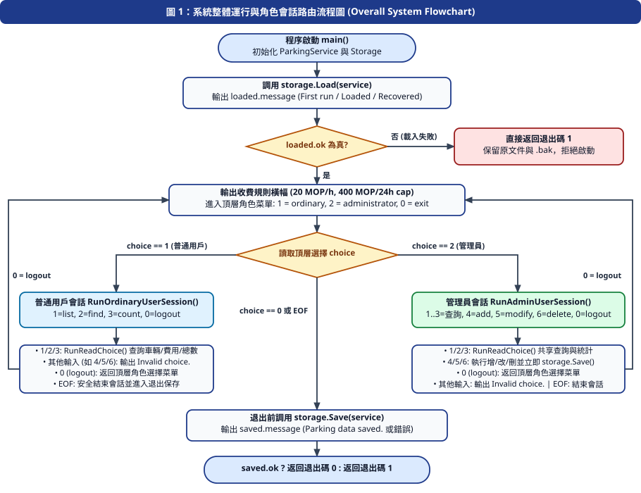
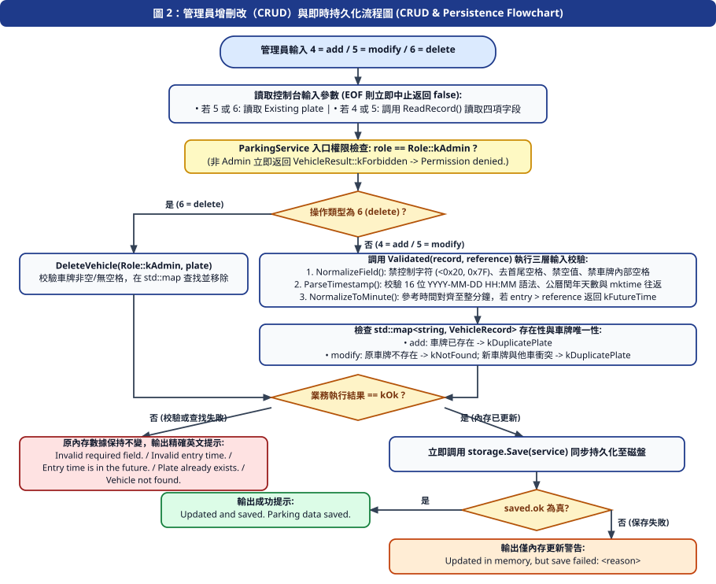
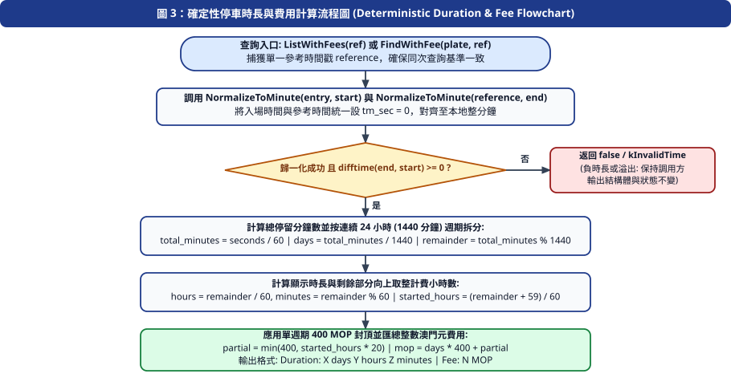
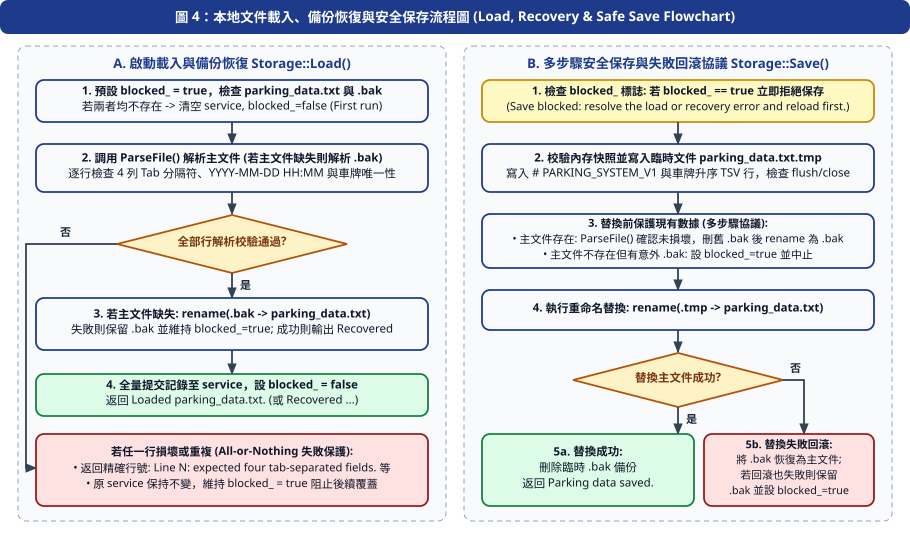

# 酒店停車場管理系統 — 系統開發報告與使用說明書

**課程名稱**：高級編程與軟件工程（期末項目）  
**項目名稱**：澳門本地酒店停車場管理系統（C++17 控制台與本地持久化實現）  
**開發團隊**：Parking Management Development Team  
**驗證基準快照**：`e06-source.zip`（SHA-256: `844645d20ca75de8d3b28a90815040f3e4d4be5da9a4a7904ae201ea6aec593e`）及 `JULI-17` Google C++ Style 已審提交 `df3a71477b3635c93c64305f2e941f0ccb5f88b2`（`refs/juli17/style`，源碼樹 `f805a58a4b143902fedd0b28d0586e59ad32ab1d`）  

---

## 第一章 項目背景與需求分析

### 1.1 項目背景與作業要求
根據《高級編程與軟件工程期末項目》任務書（`高級編程期末項目(1)(1).pdf`），澳門本地某酒店需開發一套停車場管理系統，包含**汽車信息模塊（1.1）**、**普通用戶模塊（1.2）**和**管理員用戶模塊（1.3）**三項基本功能模塊，建議分開建立文件進行編程，並提交：
1. **源代碼文件（50%）**：對程序語句或模塊進行合理注釋或解釋，基於 **C++17** 編譯並運行無報錯。
2. **全流程演示錄屏（10%）**：使用普通用戶及管理員用戶進行汽車信息錄入、查詢與刪減等全流程演示並錄屏（覆蓋 3 個基本模塊的所有功能）。
3. **系統開發報告與使用說明 PDF（40%）**：梳理開發邏輯，畫出系統整體及部分的簡單流程圖並進行說明，討論系統內可優化的邏輯及代碼部分，並附完整使用說明書。

### 1.2 需求追蹤與實現覆蓋矩陣（M01–M10）

| 編號 | 課程作業需求描述 | 實現模組與源代碼定位 | 驗證狀態與證據 |
| :--- | :--- | :--- | :--- |
| **M01** | **添加汽車信息**：錄入車牌號、汽車品類（轎車、SUV 等）、汽車顏色、停車時間點（採用手動輸入車牌號方案，排除可選 OpenCV 識別）。 | `src/vehicle.h/.cpp`、`src/parking_service.h/.cpp` (`AddVehicle`)、`src/admin_user.cpp` (`ReadRecord`) | 已通過單元測試 (`tests/test_main.cpp`) 與多進程端到端測試 (`tests/test_e2e.ps1`)。 |
| **M02** | **顯示、刪除、查找、修改汽車資訊**：輸入停車場中存在的車牌號，對汽車資訊進行顯示、查找、修改、刪除操作。 | `src/parking_service.h/.cpp` (`ListWithFees`, `FindWithFee`, `ModifyVehicle`, `DeleteVehicle`)、`src/menus.cpp` | 已通過 CRUD、改名衝突拒絕與空車庫保護測試 (`tests/test_main.cpp`, `tests/test_menus.cpp`)。 |
| **M03** | **停車時長統計**：顯示汽車在停車場中停留的時間（`X days Y hours Z minutes`）和當前在場車輛總數（`Current count`）。 | `src/fee_calculator.h/.cpp` (`CalculateParkingFee`)、`src/parking_service.h` (`Count()`) | 已通過 12 組邊界時長與數量不變量測試 (`tests/test_main.cpp`)。 |
| **M04** | **汽車資訊保存**：將汽車資訊保存到本地檔 `parking_data.txt` 中，並支持跨進程重啟載入與 `.bak` 故障恢復。 | `src/storage.h/.cpp` (`Storage::Load`, `Storage::Save`)、`src/main.cpp` | 已通過持久化與異常恢復專項測試 (`tests/test_storage.cpp`) 及 3 進程重啟測試 (`tests/test_e2e.ps1`)。 |
| **M05** | **普通用戶模塊（1.2）**：查詢、顯示所有汽車資訊及停車費資訊（每小時 20 MOP，每連續 24 小時封頂 400 MOP），停車時長統計，退出普通用戶登錄。 | `src/ordinary_user.h/.cpp` (`RunOrdinaryUserSession`)、`src/menus.cpp` (`RunReadChoice`) | 已通過普通用戶只讀會話、費用顯示與登出測試 (`tests/test_menus.cpp`, `tests/test_e2e.ps1`)。 |
| **M06** | **管理員用戶模塊（1.3）**：具備普通用戶模塊的所有功能，並具有增（`4`）、改（`5`）、刪（`6`）功能及即時保存。 | `src/admin_user.h/.cpp` (`RunAdminUserSession`)、`src/parking_service.cpp` (`Role::kAdmin` 校驗) | 已通過服務層權限攔截 (`Role::kOrdinaryUser` 返回 `kForbidden`) 與管理員全流程測試。 |
| **M07** | **分文件編程、代碼注釋與無報錯運行（50%）**：C++17 標準庫實現，3 大模塊分文件組織，遵循 Google C++ Style（含已批准 `<filesystem>` 項目級例外），開啟 `-Wall -Wextra -pedantic` 零警告零報錯。 | `src/*.h`、`src/*.cpp`（共 15 個源文件）、`tests/*`（4 個測試文件） | `g++ -std=c++17 -Wall -Wextra -pedantic -I.` 零警告編譯通過，4 套測試全部 `PASS`。 |
| **M08** | **全流程演示錄屏（10%）**：覆蓋普通用戶與管理員全部功能的實際終端錄屏。 | 演示腳本與檢查表（`JULI-13`）、實機錄屏（`JULI-14`） | 由獨立演示腳本與實機錄製覆蓋全部必選功能。 |
| **M09** | **系統開發報告與使用說明 PDF（40%）**：含開發邏輯、整體與部分流程圖、優化討論及使用說明書。 | 本報告（`juli12_development_report_zh.md` / `.pdf`）及流程圖源碼（`juli12_flowcharts.mmd`、`juli12_flowchart_1_overall.svg` 至 `juli12_flowchart_4_storage.svg`） | 全部頁面經渲染與逐頁視覺檢查確認排版清晰、圖表完整，Markdown 相對 SVG 引用通過自動檢查。 |
| **M10** | **小組提交規範**：由指定小組成員在截止日前將最新代碼、錄屏與 PDF 上傳至暢課（Changke）。 | 最終提交包審計（`JULI-15`、`JULI-16`、`JULI-18`） | 保持代碼、測試、報告與錄屏版本一致，待人工最終確認後上傳。 |

### 1.3 已批准的設計決策與範圍邊界
1. **收費規則（Approved Fee Policy）**：每開始一小時（per started hour）收費 **20 MOP**，每個連續 24 小時（1440 分鐘）週期封頂 **400 MOP**；超過 24 小時後的下一個週期按相同規則累計（例如 24 小時 1 分鐘 = `400 + 20 = 420 MOP`）。0 分鐘收費 `0 MOP`，負時長拒絕。
2. **角色會話與登出模型（Role Session Model）**：採用本地角色選擇會話（`1 = ordinary`、`2 = administrator`、`0 = exit`），每個角色會話內均提供顯式登出（`0 = logout`）返回頂層菜單，不額外引入未要求的密碼賬號註冊子系統。
3. **嚴格排除的可選功能**：不引入 OpenCV 圖像識別、GUI、網絡服務、外部數據庫、車位容量上限攔截或歷史離場歸檔表，確保核心業務邏輯純粹、可重複驗證。

---

## 第二章 系統整體架構與模塊劃分

### 2.1 分層與分文件設計
為滿足作業「建議分開建立文件進行編程」的要求並遵循軟件工程高內聚、低耦合原則，系統將控制台交互（Presentation）、業務規則與權限控制（Service/Domain）、計費算法（Fee Calculation）及本地持久化（Storage）拆分為 15 個獨立的 `.h` / `.cpp` 源文件（7 個頭文件與 8 個實現文件）：

| 模塊歸屬 | 源文件名稱 | 核心職責與導出接口 |
| :--- | :--- | :--- |
| **程序入口** | `src/main.cpp` | 初始化 `ParkingService` 與 `Storage`，啟動時調用 `storage.Load(service)`（失敗則輸出錯誤並以狀態碼 `1` 退出），進入 `RunMenu()` 主循環，正常退出時執行 `storage.Save(service)`。 |
| **會話路由與共享查詢展示** | `src/menus.h` / `src/menus.cpp` | `RunMenu()` 輸出計費規則橫幅並維護頂層角色選擇循環（`1 = ordinary, 2 = administrator, 0 = exit`）；`RunReadChoice()` 封裝兩個角色共享的只讀操作（`1 = list`、`2 = find`、`3 = count`）與統一格式化輸出 `Show()`。 |
| **1.2 普通用戶模塊** | `src/ordinary_user.h` / `src/ordinary_user.cpp` | `RunOrdinaryUserSession()` 接收只讀引用 `const ParkingService&`（無 `Storage` 引用），僅暴露查詢與統計菜單（`1 = list, 2 = find, 3 = count, 0 = logout`），在編譯期與運行期雙重杜絕普通用戶修改數據。 |
| **1.3 管理員用戶模塊** | `src/admin_user.h` / `src/admin_user.cpp` | `RunAdminUserSession()` 接收可寫 `ParkingService&` 與 `Storage&`，支持共享查詢（`1–3`）與管理員專屬增（`4`）、改（`5`）、刪（`6`）及登出（`0`）。每次修改成功後立即調用 `storage.Save(service)`，若保存失敗則輸出明確的「僅內存更新」警告。 |
| **1.1 汽車信息模塊 — 數據與時間校驗** | `src/vehicle.h` / `src/vehicle.cpp` | 定義 `VehicleRecord` 結構體；實現 `NormalizeField()`（拒絕控制字符、裁剪首尾空格、禁止車牌內部空格）、`ParseTimestamp()`（16 位 `YYYY-MM-DD HH:MM` 格式、公曆閏年天數與 `std::mktime` 往返校驗）及 `NormalizeToMinute()`（本地整分鐘歸一化）。 |
| **1.1 汽車信息模塊 — 核心業務服務** | `src/parking_service.h` / `src/parking_service.cpp` | 定義 `Role`、`VehicleResult` 枚舉與 `VehicleFeeView`；`ParkingService` 內部使用 `std::map<std::string, VehicleRecord>` 按車牌升序存儲在場車輛，集中執行 `Role::kAdmin` 權限檢查、字段/時間校驗、未來時間攔截、主鍵唯一性檢查及批量/單車計費查詢。 |
| **1.1 汽車信息模塊 — 時長與計費計算** | `src/fee_calculator.h` / `src/fee_calculator.cpp` | 定義 `ParkingFee` 結構體；實現無狀態純函數 `CalculateParkingFee(entry, reference, result)`，不依賴全局系統時鐘，便於確定性單元測試。 |
| **1.1 汽車信息模塊 — 本地文件持久化** | `src/storage.h` / `src/storage.cpp` | 定義 `StorageResult` 與 `Storage` 類；實現 `# PARKING_SYSTEM_V1` TSV 文件的全有或全無（All-or-Nothing）載入、啟動 `.bak` 自動恢復、保存前快照校驗、`.tmp` 臨時文件寫入、`.bak` 備份與失敗回滾，以及異常後的 `blocked_` 寫入鎖定保護。 |

### 2.2 核心數據結構設計

1. **車輛記錄結構體（`VehicleRecord`，定義於 `src/vehicle.h:20-26`）**：
   ```cpp
   struct VehicleRecord {
     std::string plate;             // 車牌號（唯一主鍵，無內部空格）
     std::string category;          // 汽車品類（如 轎車、SUV）
     std::string color;             // 汽車顏色（如 黑色、白色）
     std::string entry_time_text;   // 標準化入場時間文本 (YYYY-MM-DD HH:MM)
     std::time_t entry_timestamp{}; // 歸一化至本地整分鐘 (tm_sec = 0) 的時間戳
   };
   ```
2. **計費結果結構體（`ParkingFee`，定義於 `src/fee_calculator.h:19-26`）**：
   ```cpp
   struct ParkingFee {
     std::int64_t total_minutes = 0;                 // 總停留分鐘數
     std::int64_t days = 0;                          // 完整 24 小時天數 (total_minutes / 1440)
     int hours = 0;                                  // 剩餘部分小時數 ((total_minutes % 1440) / 60)
     int minutes = 0;                                // 剩餘部分分鐘數 (total_minutes % 60)
     int started_hours_in_partial_block = 0;         // 剩餘部分向上取整計費小時數
     std::int64_t mop = 0;                           // 應收澳門元整數金額 (MOP)
   };
   ```
3. **內存容器選型（`std::map<std::string, VehicleRecord>`）**：
   `ParkingService` 選用標準庫紅黑樹映射 `std::map` 以車牌 `plate` 作為鍵，保證按車牌查找、插入、刪除的時間複雜度為 `O(log N)`，且在執行列表顯示（`ListAll` / `ListWithFees`）與文件落盤（`Storage::Save`）時天然保持確定性的車牌字典序升序輸出。

---

## 第三章 系統整體與核心模塊流程圖及開發邏輯說明

本章節繪製了系統整體控制流與三個關鍵子模塊（管理員增刪改查與保存、確定性時長與費用計算、本地文件載入與安全保存）的流程圖，所有分支、提示與內部符號均與已通過審查的 `E06` / `JULI-17` 代碼完全一致。

### 3.1 系統整體運行與角色會話路由流程圖（Overall System Flowchart）

**邏輯說明（對應 `src/main.cpp`、`src/menus.cpp`、`src/ordinary_user.cpp`、`src/admin_user.cpp`）**：
1. 程序啟動後首先調用 `storage.Load(service)` 檢查並載入 `parking_data.txt`（若主文件缺失但 `.bak` 存在則自動恢復）。若文件損壞或無法讀取，輸出具體行號/原因並直接返回退出碼 `1`，絕不覆蓋損壞文件。
2. 載入成功後，打印收費標準說明，進入 `RunMenu` 頂層角色選擇循環：輸入 `1` 進入普通用戶會話，輸入 `2` 進入管理員會話，輸入 `0` 或遇到 `EOF` 退出循環。
3. 普通用戶會話僅能執行 `1 = list`、`2 = find`、`3 = count` 與 `0 = logout`；管理員會話除上述三項外還可執行 `4 = add`、`5 = modify`、`6 = delete`，且每次寫操作成功後立即觸發 `storage.Save(service)`。
4. 頂層菜單退出時，主函數再次調用 `storage.Save(service)` 確認落盤並根據保存結果返回退出碼 `0` 或 `1`。



---

### 3.2 管理員增刪改（CRUD）與即時持久化流程圖（Module Flowchart 1）

**邏輯說明（對應 `src/admin_user.cpp:58-92` 與 `src/parking_service.cpp:20-85`）**：
1. 在管理員會話中選擇 `4`（添加）、`5`（修改）或 `6`（刪除）。若為 `5` 或 `6`，首先讀取目標車牌 `Existing plate`；若為 `4` 或 `5`，調用 `ReadRecord()` 讀取四項字段（`Plate`、`Category`、`Color`、`Entry time`）。
2. `ParkingService` 首先在服務層入口強制檢查 `role == Role::kAdmin`（若非管理員則返回 `VehicleResult::kForbidden`）。
3. 調用 `Validated()` 進行三層嚴格校驗：
   - `NormalizeField()`：拒絕任何 ASCII 控制字符（`< 0x20` 或 `0x7F`），裁剪首尾空格，拒絕空字串，並禁止 `plate` 內部包含空格。
   - `ParseTimestamp()`：檢查 16 字符 `YYYY-MM-DD HH:MM` 語法、公曆每月天數（含閏年 2 月 29 日規則）及 `std::mktime` 往返一致性。
   - `NormalizeToMinute()`：將系統當前參考時間歸一化至整分鐘，若 `entry_timestamp > minute` 則判定為未來時間並返回 `VehicleResult::kFutureTime`。
4. 檢查車牌存在性與唯一性：添加時若車牌已存在，或修改車牌名稱時新車牌與其他在場車輛衝突，均返回 `kDuplicatePlate`，且**保持原內存數據不變**。
5. 內存更新成功後，立即調用 `storage.Save(service)`：若保存成功則輸出 `Updated and saved. Parking data saved.`；若磁盤保存失敗，輸出警告 `Updated in memory, but save failed: <reason>`，明確告知用戶變更僅在內存生效而未落盤。



---

### 3.3 確定性停車時長與費用計算流程圖（Module Flowchart 2）

**邏輯說明（對應 `src/fee_calculator.cpp:22-45` 與 `src/parking_service.cpp:99-124`）**：
1. 批量列表查詢 `ListWithFees()` 在開始時僅捕獲一次參考時間戳並歸一化至本地整分鐘，確保同一張列表內所有車輛的時長與費用基於完全一致的時間基準。
2. `CalculateParkingFee(entry, reference, result)` 將入場時間 `entry` 與參考時間 `reference` 均通過 `NormalizeToMinute()` 抹除秒數（設 `tm_sec = 0`），消除實時秒數引起的跨分鐘/跨小時邊界抖動。
3. 計算秒數差 `seconds = std::difftime(end, start)`：若 `seconds < 0`（負時長）、非有限值或超出整數安全上限，立即返回 `false` 並保持調用方輸出結構體不變。
4. 將總分鐘數 `total_minutes = seconds / 60` 拆分為：
   - 完整 24 小時天數：`days = total_minutes / 1440`（每天固定收費 `400 MOP`）。
   - 剩餘不滿一天分鐘數：`remainder = total_minutes % 1440`，折算為顯示小時 `hours = remainder / 60` 與顯示分鐘 `minutes = remainder % 60`。
   - 剩餘部分向上取整計費小時數：`started_hours = (remainder + 59) / 60`，部分費用 `partial = min(400, started_hours * 20)`。
   - 總費用：`mop = days * 400 + partial`。



---

### 3.4 本地文件載入、備份恢復與安全保存流程圖（Module Flowchart 3）

**邏輯說明（對應 `src/storage.cpp:29-177`）**：
1. **啟動載入與 `.bak` 自動恢復（`Storage::Load`）**：
   - 默認先將寫入鎖定標誌設為 `blocked_ = true`。
   - 若 `parking_data.txt` 與 `parking_data.txt.bak` 均不存在，初始化空車庫並解除鎖定（`blocked_ = false`），返回 `First run: no parking data file.`。
   - 若主文件存在則解析主文件；若主文件缺失但 `.bak` 存在，則解析 `.bak` 並將其重命名恢復為主文件（返回 `Recovered parking data from parking_data.txt.bak.`）。
   - `ParseFile()` 採用**全有或全無（All-or-Nothing）**策略：逐行解析 4 列 Tab 分隔字段並校驗時間戳與車牌唯一性；一旦某行格式錯誤或車牌重複，立即中止並返回精確行號（如 `Line 3: expected four tab-separated fields.`），原 `service` 保持不變且 `blocked_` 維持為 `true`，防止後續保存覆蓋損壞文件或備份。
2. **多步驟文件保存與回滾協議（Multi-step Save & Rollback Protocol，`Storage::Save`）**：
   - 若 `blocked_ == true`，直接拒絕保存（`Save blocked: resolve the load or recovery error and reload first.`）。
   - 先在內存中對待保存的所有記錄做二次完整校驗，隨後寫入臨時文件 `parking_data.txt.tmp` 並檢查 `flush()` / `close()` 流狀態（寫入失敗則刪除 `.tmp` 並保留原文件）。
   - 若目標文件 `parking_data.txt` 已存在，先調用 `ParseFile()` 確認磁盤上的當前文件未被外部改壞（若已損壞則設 `blocked_ = true`、刪除 `.tmp` 並中止保存），再移除舊 `.bak` 並將原文件重命名備份為 `parking_data.txt.bak`；若目標文件不存在但檢測到殘留 `.bak`（或無法檢查 `.bak`），則設 `blocked_ = true` 並拒絕保存（`Backup exists or cannot be inspected; reload to recover before saving.`）。
   - 將 `.tmp` 重命名為 `parking_data.txt`：若替換失敗，自動嘗試將 `.bak` 重命名回滾為 `parking_data.txt`（若回滾也失敗則保留 `.bak` 並設 `blocked_ = true`，輸出 `Replacement and rollback failed; preserve backup ...`）；若替換成功，清理臨時 `.bak`（若清理 `.bak` 失敗則返回 `Saved; old backup could not be removed: ...`）並返回 `Parking data saved.`。



---

## 第四章 測試驗證結果與質量審計

系統配備了 4 套自動化測試程序（零外部測試框架依賴，純 C++17 標準庫與 PowerShell 腳本），並在 `JULI-9`（`Q01`）、`JULI-10`（`Q02`）、`JULI-11`（`D02`）與 `JULI-17`（Google C++ Style 整理及獨立復驗）中完成了獨立復現驗證：

| 測試程序 / 腳本 | 編譯與執行命令 | 覆蓋範圍 | 實際運行輸出與結果 |
| :--- | :--- | :--- | :--- |
| **核心單元測試** (`tests/test_main.cpp`) | `g++ -std=c++17 -Wall -Wextra -pedantic -I. -Isrc tests/test_main.cpp src/menus.cpp src/ordinary_user.cpp src/admin_user.cpp src/vehicle.cpp src/parking_service.cpp src/fee_calculator.cpp src/storage.cpp -o build/tests.exe` 並執行 `./build/tests.exe` | 菜單無效輸入與 `EOF`、12 組計費邊界值（`0m` 至 `2881m`）、負時長拒絕、普通用戶越權攔截 (`kForbidden`)、字段空格/控制字符/閏年/未來時間校驗、車牌重複與改名衝突拒絕、數量統計與字典序排列。 | `All foundation, vehicle service and fee tests passed.`（退出碼 `0`，0 警告） |
| **持久化與恢復測試** (`tests/test_storage.cpp`) | `g++ -std=c++17 -Wall -Wextra -pedantic -I. -Isrc tests/test_storage.cpp src/vehicle.cpp src/parking_service.cpp src/fee_calculator.cpp src/storage.cpp -o build/test_storage.exe` 並執行 `./build/test_storage.exe` | 首次運行空文件、UTF-8 中文品類/顏色增刪改落盤與重啟載入、`.bak` 中斷恢復、損壞行 (`Line 3`) 全有或全無攔截與保存鎖定、重複車牌攔截、損壞 `.bak` 保留與不可寫路徑處理。 | `All persistence and recovery tests passed.`（退出碼 `0`，0 警告） |
| **菜單與保存失敗測試** (`tests/test_menus.cpp`) | `g++ -std=c++17 -Wall -Wextra -pedantic -I. -Isrc tests/test_menus.cpp src/menus.cpp src/ordinary_user.cpp src/admin_user.cpp src/vehicle.cpp src/parking_service.cpp src/fee_calculator.cpp src/storage.cpp -o build/test_menus.exe` 並執行 `./build/test_menus.exe` | 管理員增刪改查、切換普通用戶查詢時長與費用、普通用戶輸入 `4` 拒絕、重啟載入驗證，以及保存被鎖定時的 `Updated in memory, but save failed:` 警告驗證。 | `Menu workflow and save failure tests passed.`（退出碼 `0`，0 警告） |
| **多進程端到端測試** (`tests/test_e2e.ps1`) | `./tests/test_e2e.ps1` | 在隔離目錄下連續啟動 3 個獨立 `parking.exe` 進程，完整驗證空車庫、普通用戶權限攔截、管理員錄入、重複/改名衝突攔截、修改、普通用戶查詢費用/時長/總數、TSV 落盤內容、重啟載入、刪除與刪除後重啟驗證。 | `End-to-end multi-process workflow passed.`（退出碼 `0`） |

> **編譯與測試邊界披露**：上述 4 套驗證及 `clang-format 23.1.1` / `cpplint 2.0.2` 規範檢查已在 Windows（`x86_64-w64-windows-gnu`, UCRT）本地時區實機通過；Linux/macOS POSIX 目標環境與夏令時（DST）跳變時刻未實機執行；底層 `.tmp` 寫入磁盤滿、OS 級重命名/回滾失敗與文件鎖/ACL 拒絕分支經靜態代碼對照驗證，未做動態故障注入。

---

## 第五章 系統局限性與可優化的邏輯及代碼討論

根據作業要求二（3）「討論系統內是否有可優化的邏輯及代碼部分」，本章節在不改動已凍結基線功能的前提下，從算法複雜度、I/O 性能、並發安全與工程擴展四個維度對當前系統進行客觀分析與優化探討：

### 5.1 現有設計的局限性分析
1. **每次修改全量重寫與預校驗的 `O(N)` I/O 開銷**：
   - 在 `src/storage.cpp:106-143` 中，`Storage::Save()` 每次保存時會先將內存中的全部記錄拷貝至臨時 `ParkingService checked` 進行二次校驗，並且當 `parking_data.txt` 已存在時，會先調用 `ParseFile(path_, current)` 讀取並校驗磁盤上的舊文件，隨後再將全部記錄寫入 `.tmp`。
   - **局限性**：對於酒店停車場日常百輛至千輛規模的在場車輛，全量讀寫耗時僅在毫秒級，且能提供極高的數據防損壞安全性；但若車庫規模擴展至十萬級以上，每次單車增刪改都觸發 `O(N log N)` 的全量解析與重寫，會產生明顯的磁盤 I/O 放大。
2. **多步驟文件重命名的非事務性（Non-Atomic Multi-Rename）**：
   - 在標準 C++17 `std::filesystem` 中，跨平台文件替換需依次執行 `rename(target, backup)` 與 `rename(temp, target)` 兩步操作。雖然系統設計了回滾與啟動時自動從 `.bak` 恢復的閉環機制，但它屬於「可恢復的多步協議（Recoverable Protocol）」，而非操作系統內核級的單步原子事務（如 POSIX 同目錄 `rename` 覆蓋或 Windows `ReplaceFileW` / NTFS TxF）。
3. **單進程獨佔模式與缺乏文件鎖（File Locking）**：
   - 系統假設同一時間僅有一個控制台進程讀寫同一份 `parking_data.txt`。若多個終端窗口同時啟動並併發修改同一文件，後保存的進程會覆蓋先保存進程的變更。
4. **本地時區與夏令時（DST）轉換邊界**：
   - 時間解析與分鐘歸一化依賴 C 標準庫 `std::localtime` 與 `std::mktime`（`tm_isdst = -1`）。在澳門（UTC+8，無夏令時）環境下完全精確且單調；但若部署在實行夏令時的地區，每年夏令時回撥的 1 小時重疊窗口內可能出現本地時間文本歧義。

### 5.2 可優化的代碼與邏輯方向（未來演進建議）
1. **引入追加式預寫日誌（Append-Only WAL / Journal）與定期壓縮（Compaction）**：
   - **優化方案**：管理員執行單次 `add`、`modify`、`delete` 時，僅以 `O(1)` 時間向日誌文件追加一行增量操作記錄並 `flush`；僅在程序正常退出或日誌達到閾值時執行一次全量快照合併（Compaction）。這樣既保留了崩潰恢復能力，又將單次寫操作的磁盤 I/O 複雜度從 `O(N)` 降至 `O(1)`。
2. **消除保存路徑上的冗餘內存重構**：
   - **優化方案**：由於 `ParkingService` 的所有公開寫接口（`AddVehicle`、`ModifyVehicle`）在寫入 `records_` 前已經強制通過了 `Validated()` 校驗，內存中的 `VehicleRecord` 始終滿足不變量。因此 `Storage::Save()` 中的 `ParkingService checked` 二次插入（`src/storage.cpp:106-115`）可簡化為輕量級的字段斷言，將保存時的內存分配與紅黑樹插入開銷減少 50%。
3. **雙索引或哈希索引加速單車查找（`std::unordered_map` + 有序視圖）**：
   - **優化方案**：當前 `std::map` 查找為 `O(log N)`。若高頻執行單車牌精確查找（`FindByPlate` / `FindWithFee`），可增加 `std::unordered_map<std::string, VehicleRecord>` 實現 `O(1)` 平均查找，或僅在需要按車牌有序輸出時對指針數組排序。
4. **時間類型升級至 C++20 `std::chrono::utc_clock` / `sys_minutes`**：
   - **優化方案**：若未來升級編譯標準至 C++20，可使用 `<chrono>` 日曆庫（`std::chrono::year_month_day` 與 `std::chrono::sys_minutes`）替代傳統 `std::tm` / `std::mktime`，實現無鎖、線程安全且與時區無關的日期算術。

---

## 第六章 系統使用說明書（普通用戶與管理員操作指南）

*(本章節完整納入經 `JULI-11` 實機交互核驗通過的使用說明書，供最終用戶與評審教師查閱。)*

### 6.1 系統簡介與功能範圍
本系統包含三項必選模塊：
1. **汽車信息模塊（1.1）**：支持手動錄入車牌號（`Plate`）、汽車品類（`Category`）、汽車顏色（`Color`）及停車時間點（`Entry time`，格式 `YYYY-MM-DD HH:MM`）；支持按車牌號顯示、查找、修改和刪除車輛；支持統計停留時長（`X days Y hours Z minutes`）與在場車輛總數（`Current count`）；支持本地文件 `parking_data.txt` 自動保存與重啟載入。
2. **普通用戶模塊（1.2）**：支持顯示所有車輛與費用（`1 = list`）、按車牌查詢單車與費用（`2 = find`）、統計在場車輛總數（`3 = count`）及退出普通用戶登錄（`0 = logout`）。普通用戶無權執行任何增刪改操作。
3. **管理員用戶模塊（1.3）**：具備普通用戶所有查詢統計功能（`1–3`），並支持添加（`4 = add`）、修改（`5 = modify`）、刪除（`6 = delete`）及退出登錄（`0 = logout`）。

> **範圍說明**：本系統採用手動輸入車牌號方案，不包含可選的 OpenCV 圖像識別、GUI、外部數據庫、密碼註冊系統、車位上限攔截或歷史離場記錄表。

### 6.2 環境要求、編譯與啟動步驟

1. **前置環境**：支持 C++17 的編譯器（如 `g++` 或 `clang++`）。在 Windows PowerShell 下交互輸入或查看中文品類/顏色前，建議先設置 UTF-8 編碼：
   ```powershell
   [Console]::InputEncoding = [System.Text.UTF8Encoding]::new($false)
   [Console]::OutputEncoding = [System.Text.UTF8Encoding]::new($false)
   $OutputEncoding = [System.Text.UTF8Encoding]::new($false)
   ```
2. **編譯與啟動主程序**：
   ```powershell
   New-Item -ItemType Directory -Force build
   g++ -std=c++17 -Wall -Wextra -pedantic -I. -Isrc src/*.cpp -o build/parking.exe
   ./build/parking.exe
   ```
3. **啟動載入提示與頂層角色選擇菜單**：
   - 首次運行顯示：`First run: no parking data file.`
   - 已有數據文件顯示：`Loaded parking_data.txt.`
   - 從備份恢復顯示：`Recovered parking data from parking_data.txt.bak.`
   - 隨後顯示收費規則與頂層菜單：
     ```text
     Fee: 20 MOP per started hour, capped at 400 MOP per successive 24-hour block.
     Parking system: 1 = ordinary, 2 = administrator, 0 = exit
     > 
     ```
   - 輸入 `1` 進入普通用戶會話，輸入 `2` 進入管理員會話，輸入 `0` 保存並退出程序（輸出 `Parking data saved.`）。

### 6.3 普通用戶操作步驟（`1 = ordinary`）
進入普通用戶會話後，菜單提示如下：
```text
Ordinary user session: 1 = list, 2 = find, 3 = count, 0 = logout
> 
```
- **`1`（顯示全部車輛、時長與費用）**：
  - 車庫為空時輸出 `No vehicles.` 與 `Current count: 0`。
  - 車庫有車時按車牌字典序升序逐行輸出：
    ```text
    Plate: MA-12-34 | Category: 轎車 | Color: 銀色 | Entry: 2026-11-01 08:00 | Duration: 0 days 21 hours 40 minutes | Fee: 400 MOP
    Plate: MB-56-78 | Category: SUV | Color: 白色 | Entry: 2026-11-02 04:00 | Duration: 0 days 1 hours 40 minutes | Fee: 40 MOP
    Current count: 2
    ```
- **`2`（按車牌查詢單車資訊與費用）**：在 `Plate: ` 提示後輸入車牌號。若存在則輸出該車完整資訊；若不存在則輸出 `Vehicle not found.`；若輸入格式非法則輸出 `Unable to retrieve vehicle or calculate duration.`；無論命中或未命中，最後均會附帶輸出一行 `Current count: N`。
- **`3`（統計當前在場車輛總數）**：輸出 `Current count: N`。
- **`0`（退出普通用戶登錄）**：返回頂層菜單 `Parking system: 1 = ordinary, 2 = administrator, 0 = exit`。若輸入 `4`、`5`、`6` 等非授權選項，系統拒絕並輸出 `Invalid choice.`。

### 6.4 管理員操作步驟（`2 = administrator`）
進入管理員會話後，菜單提示如下：
```text
Administrator session: 1 = list, 2 = find, 3 = count, 4 = add, 5 = modify, 6 = delete, 0 = logout
> 
```
- **`1`、`2`、`3`（共享查詢與統計）**：與普通用戶功能完全相同。
- **`4`（添加車輛）**：依次按提示輸入 `Plate: `、`Category: `、`Color: `、`Entry time (YYYY-MM-DD HH:MM): `。驗證通過並保存成功後輸出：
  ```text
  Updated and saved. Parking data saved.
  ```
- **`5`（修改車輛）**：先在 `Existing plate: ` 輸入場內現存車牌，再依次輸入修改後的 `Plate`、`Category`、`Color`、`Entry time (YYYY-MM-DD HH:MM)`。成功後輸出 `Updated and saved. Parking data saved.`。
- **`6`（刪除車輛）**：在 `Existing plate: ` 輸入待刪除車牌，成功後輸出 `Updated and saved. Parking data saved.`。
- **`0`（退出管理員登錄）**：返回頂層角色選擇菜單。

### 6.5 停車費計算規則與邊界對照表
系統將入場時間與當前查詢時間統一歸一化至本地整分鐘（`tm_sec = 0`），按以下規則計算整數澳門元（`MOP`）費用：
- **0 分鐘停留**：`0 MOP`。
- **分段封頂計費**：每滿一個連續 24 小時（1440 分鐘）週期收費 `400 MOP`；剩餘不滿 24 小時的部分按「每開始 1 小時（向上取整）收費 20 MOP、最高封頂 400 MOP」計算。

| 停留總時長 | 終端顯示時長 (`Duration`) | 應收費用 (`Fee`) | 規則說明 |
| :--- | :--- | :--- | :--- |
| `0` 分鐘 | `0 days 0 hours 0 minutes` | `0 MOP` | 同一分鐘內查詢免費 |
| `1` 分鐘 | `0 days 0 hours 1 minutes` | `20 MOP` | 不足 1 小時按 1 小時計算 |
| `60` 分鐘 | `0 days 1 hours 0 minutes` | `20 MOP` | 整 1 小時 |
| `61` 分鐘 | `0 days 1 hours 1 minutes` | `40 MOP` | 進入第 2 個計費小時 |
| `20` 小時 (`1200m`) | `0 days 20 hours 0 minutes` | `400 MOP` | 達到單個 24 小時週期 400 MOP 封頂 |
| `24` 小時 (`1440m`) | `1 days 0 hours 0 minutes` | `400 MOP` | 1 個完整 24 小時週期 |
| `24` 小時 `1` 分鐘 (`1441m`) | `1 days 0 hours 1 minutes` | `420 MOP` | 首日 400 MOP + 次日第 1 小時 20 MOP |
| `48` 小時 (`2880m`) | `2 days 0 hours 0 minutes` | `800 MOP` | 2 個完整 24 小時週期 |

### 6.6 字段校驗、本地文件格式與異常恢復速查表
- **本地數據文件**：默認位於當前工作目錄下的 `parking_data.txt`（UTF-8 編碼，首行為 `# PARKING_SYSTEM_V1`，每行 4 個以 Tab `\t` 分隔的字段：`車牌\t品類\t顏色\tYYYY-MM-DD HH:MM`）。
- **常見提示與故障恢復對照表**：

| 終端精確英文提示 | 觸發原因與恢復操作 |
| :--- | :--- |
| `Invalid choice.` | 輸入了無效菜單編號；請按菜單提示重新輸入有效數字。 |
| `Invalid required field.` | 車牌/品類/顏色為空、車牌含內部空格（如 `MA 12`）或含控制字符；請修正後重試。 |
| `Invalid entry time.` | 時間不符合 16 位 `YYYY-MM-DD HH:MM` 格式或日曆日期不存在（如平年 `2026-02-29`）；請按正確格式重輸。 |
| `Entry time is in the future.` | 入場時間晚於當前系統時間；請輸入過去或當前的時間點。 |
| `Plate already exists.` | 添加了重複車牌，或修改車牌時目標新車牌已被佔用；請使用唯一車牌。 |
| `Vehicle not found.` | 查詢、修改或刪除的目標車牌不存在；可先輸入 `1` 查看全部在場車牌。 |
| `Updated in memory, but save failed: <reason>` | **僅內存更新警告**：管理員修改已在當前會話內存生效，但寫入磁盤失敗（如 `.tmp` 權限不足或目錄衝突）。請根據 `<reason>` 排除磁盤權限/文件衝突後再次執行保存或正常退出。 |
| `Line N: expected four tab-separated fields.` / `invalid timestamp.` / `duplicate plate.` | 啟動時發現 `parking_data.txt` 第 `N` 行被外部破壞。系統拒絕半載入並鎖定保存（退出碼 `1`）；請用文本編輯器修復第 `N` 行後重啟程序。 |
| `Save blocked: resolve the load or recovery error and reload first.` | 因載入失敗、備份恢復失敗或保存前發現磁盤文件被外部改壞而觸發安全鎖定；請先檢查並保留 `parking_data.txt` 與 `parking_data.txt.bak`，修復後重啟程序。 |
